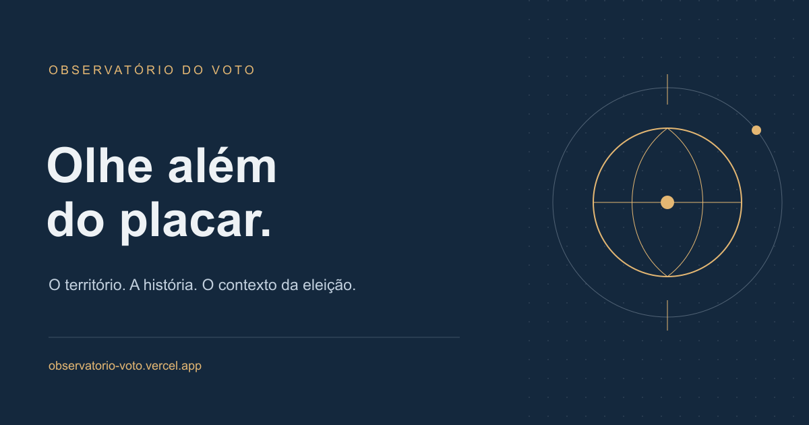

# Observatório do Voto

O Brasil, voto a voto. Explore as eleições presidenciais com resultados, pesquisas, mapas e fontes em uma interface gratuita para celular e computador.

[**Acessar o site**](https://observatorio-voto.vercel.app/)

## O que você encontra

- **Panorama e histórico:** consulte resultados por estado e região e compare eleições presidenciais de 1989 a 2022. Os dados indicam suas fontes e eventuais limitações.
- **Seu município:** escolha o primeiro ou o segundo turno de 2026. O segundo permite consultar município e zona no TSE e ler o boletim oficial de uma seção, com indicação de seções agregadas. A busca pelo nome e o total por colégio continuam limitados ao acervo do primeiro turno. A cidade fica lembrada neste navegador; links preservam o turno. Os números são coletivos e não revelam o voto de uma pessoa.
- **Pesquisas:** compare levantamentos, datas e bases; abra os detalhes para conferir amostra, margem de erro, metodologia e relatório original.
- **Resultados e pós-eleição:** veja o resultado oficial, o contexto datado dos desdobramentos e compare 2026 com segundos turnos anteriores ou entre os dois turnos de 2026. A comparação permite Brasil, regiões e UFs, identifica candidatos diferentes e calcula a variação agregada do PT.
- **Cobertura:** leia manchetes de veículos brasileiros e acesse as matérias nos sites de origem.
- **Meu acompanhamento:** siga estados e registre observações no caderno com salvamento automático no aparelho.
- **Alertas:** escolha avisos de pesquisas, notícias, liderança e resultados; consulte as notificações recebidas neste dispositivo.

O menu fica disponível durante a navegação. Seções extensas podem ser recolhidas; mapas e gráficos também oferecem consultas por texto ou tabela. O tema acompanha o sistema, com opções Claro e Escuro, e as animações respeitam a preferência por movimento reduzido.

A evolução de 2026 mostra os boletins efetivamente registrados pelo serviço ou pela sessão. O app não preservou a sequência completa da noite antes desta atualização; um único boletim final não é apresentado como uma curva. O replay nacional de 2022 usa uma série real do TSE, identificada separadamente. Resultados finais de 2026 foram coletados nos dois turnos para Brasil e 27 UFs; fontes, horários e IDs estão em `public/data/final-2026-sources.json`, com coleta reproduzível por `npx tsx scripts/collect-final-2026.ts`.

## Comece a usar

Abra o site; não é necessário criar uma conta. As boas-vindas permitem personalizar seu acompanhamento e a quantidade de detalhes nas pesquisas. Essas escolhas podem ser alteradas no perfil. Leia os [Termos de Uso](https://observatorio-voto.vercel.app/termos) antes de continuar.

Use os filtros para escolher eleição, turno ou região. Nas pesquisas, **Entre quem escolheu um candidato** e **Incluindo brancos, nulos e indecisos** representam bases diferentes do mesmo levantamento. Bases não publicadas pelo instituto ficam identificadas, sem números estimados. A simulação de transferência de votos é uma hipótese pessoal, sem valor de pesquisa ou previsão.

Compartilhe notícias ou consultas pelos controles do app. Links de resultados incluem os filtros escolhidos, sem enviar seu nome, candidato preferido ou anotações.

## Instale e receba alertas

Use **Instalar app** quando o navegador oferecer essa opção; **Como instalar** mostra as instruções nos demais casos. No iPhone compatível, adicione o app à tela inicial antes de ativar as notificações.

Ative os avisos nas boas-vindas ou em **Alertas**, permita o envio no navegador e escolha os eventos desejados. Use o teste para conferir o recebimento. Atualizações comuns são agrupadas e podem ser limitadas por hora ou por dia; eventos decisivos selecionados têm prioridade. O histórico guarda até 50 avisos dos últimos 30 dias no aparelho.

Com o app aberto, a apuração é consultada a cada 30 segundos. Um monitor consulta as fontes em intervalos previstos de cinco minutos mesmo sem visitantes, sujeitos a atrasos. Consulta e entrega dependem das fontes, permissões, conexão e sistema do aparelho; notificações podem atrasar ou não chegar. Nem todos os institutos oferecem integração automática para seus percentuais.

Em **Meu app**, guarde um resultado nacional finalizado para leitura offline. Essa área também mostra as anotações já salvas, sem atualizar pesquisas ou apuração ao vivo. Na tela da apuração, aparelhos compatíveis podem manter a tela acesa mediante sua escolha.

## Privacidade e fontes

No início do Panorama, antes do mapa, escolha **Quero personalizar** ou **Prefiro a visão padrão**. A decisão fica salva e **Escolher minha experiência** permite revisá-la. As boas-vindas também têm uma etapa própria de personalização. Com autorização, o app aprende com consultas e aberturas de matérias, sem exigir avaliações. **Mais disso**, **Menos disso** e **Desfazer** são correções opcionais. Notícias e publicações podem ser organizadas **Para você** ou por **Mais recentes**, sempre com todas as fontes disponíveis. A leitura também pode se ajustar depois de várias interações com detalhes. No Perfil, pause, mantenha o nível manual ou apague o aprendizado.

O aprendizado fica no aparelho. Se autorizar separadamente **Adaptar também o ritmo dos alertas**, um resumo de até três assuntos gerais vai ao servidor por até sete dias, permitindo agrupar assuntos menos acompanhados em intervalos diários mesmo com o app fechado. Não envia histórico de leituras, candidatos ou lugares. Suas categorias, frequência máxima e marcos decisivos continuam valendo. A sincronização exige conexão; falhas aparecem em Alertas. Não há mudança dos números oficiais, inferência de voto ou custo adicional por essa personalização.

Preferências e anotações permanecem neste navegador. Limpar seus dados, usar outro aparelho ou navegar em modo privado pode remover essas configurações. Elas não formam um perfil público e não são sincronizadas entre aparelhos. As inscrições push são mantidas no servidor para permitir o envio de alertas; confira o [Aviso de Privacidade](https://observatorio-voto.vercel.app/privacidade).

Resultados eleitorais usam o TSE como referência; o território usa o IBGE. Pesquisas e notícias identificam suas fontes. Intenção de voto não é resultado oficial nem garantia de vitória. Falhas ou dados ainda não disponíveis são sinalizados; não são substituídos por números inventados.

O app não oferece edição de resultados oficiais nem acesso ao engajamento individual de eleitores nas redes sociais. Imagens de notícias e notificações dependem da disponibilidade do veículo e do suporte do aparelho.

## Sugestões e contribuição

Este é um projeto pessoal de Alejandro Cortes, desenvolvido com assistência de IA. Minha participação inclui a definição das funcionalidades, testes de uso e priorização de ajustes: navegação no celular, exploração do município, instalação do PWA e organização dos alertas. A implementação e a manutenção são acompanhadas por testes automatizados e verificações em produção; o uso de IA não substitui essas validações.

As [decisões de produto e implementação](docs/development.md#decisões-e-evidências) explicam escolhas como a conferência das pesquisas, preferências locais e o monitoramento sem visitantes.

Relate problemas ou sugestões em [Issues](https://github.com/alejandroBR17/observatorio-do-voto/issues), informando a tela, o comportamento esperado e o navegador. Não publique dados pessoais, tokens ou preferências políticas.

Para trabalhar no código, consulte o [guia de desenvolvimento](docs/development.md). A hospedagem está no [guia de publicação](docs/deployment.md); atribuições e direitos de terceiros estão em [NOTICE.md](NOTICE.md), e relatos de vulnerabilidade seguem [SECURITY.md](SECURITY.md).

O código original é disponibilizado sob a [licença MIT](LICENSE). Dados, fotografias, marcas e outros materiais de terceiros seguem as condições descritas nas atribuições.
