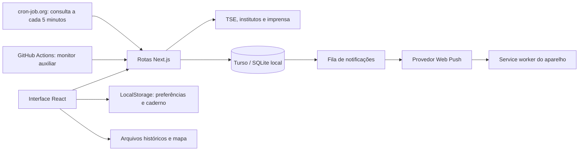

# Guia de desenvolvimento

Este guia reúne instalação local, organização, contratos do servidor e verificação. Para publicar, consulte [deployment.md](deployment.md).

Os controles de privacidade, retenção, atendimento e pendências de fornecedores e conteúdo estão na [revisão de privacidade](privacy-review.md). Mudanças em dados pessoais ou novas finalidades devem atualizar esse registro e os avisos públicos.

### Proteção das notificações e do navegador

`lib/push-rate-limit.ts` usa contadores atômicos no banco compartilhado, em janelas de 15 minutos. Por IP: 120 atualizações de inscrição, 30 novas inscrições, 30 solicitações de teste e 600 consultas de recibo. Novas inscrições têm também teto compartilhado de 300 por janela; testes, 200. O limite anterior de um teste por minuto por aparelho continua ativo. Esses limites protegem operações da API e não alteram a frequência escolhida para receber notícias. Cancelamentos não são bloqueados pelo limite de cadastro.

Na Vercel, somente `x-vercel-forwarded-for` identifica o cliente; fora dela, o grupo local é usado. O IP não é gravado em texto: o identificador usa HMAC com segredo do servidor e muda diariamente. Reutiliza `CRON_SECRET`, ou o componente privado das chaves VAPID existentes no desenvolvimento, sem girar chaves ou criar uma credencial. Contadores expiram após 24 horas, removidos pelo monitor. Respostas 429 incluem `Retry-After`; falhas de armazenamento mantêm as operações protegidas indisponíveis. Redes compartilhadas dividem o limite e ataques distribuídos podem exigir proteção adicional na plataforma.

`limitedJson` limita os corpos de inscrição, revogação, testes e recibos a 8 KiB, mesmo sem `Content-Length`. Excesso retorna 413. Não registra corpos, chaves ou endereços de inscrição.

`proxy.ts` gera um nonce criptográfico novo para cada resposta HTML. O layout usa renderização dinâmica e o nonce tanto nos scripts do Next.js quanto no script de tema. HTML não é compartilhado pelo CDN; isso aumenta o processamento do servidor dentro das cotas do plano. Scripts de produção não permitem `unsafe-inline` ou `unsafe-eval`. Estilos inline permanecem permitidos para gráficos e controles; imagens ficam nos domínios aceitos pelo app, fontes e service worker no próprio site. O documento offline tem uma política própria para seus arquivos locais. A atualização do cache offline não apaga preferências ou anotações.

Ao alterar scripts, domínios de imagem ou Analytics, testar o build de produção no navegador e conferir violações de CSP. Não testar limites enviando cadastros falsos ou cargas excessivas à produção: usar os testes com banco em memória. Não relaxar a CSP para esconder falhas de integração.

## Contribuir com o Observatório do Voto

### Fontes e indexação

Os relatórios nacionais de 13/10/2026 de PoderData/Aya, Gerp, BTG/Nexus e Futura/100 Cidades foram conferidos antes de entrar no catálogo. O relatório da Nexus está disponível também no [PDF da 17ª rodada](https://static.poder360.com.br/uploads/2026/10/BTG-Nexus-Eleicoes-2026-Rodada-17-13.out_.2026.pdf). O Datafolha disponibilizou em 13/10 o relatório da rodada de 8/10; a data original do levantamento foi preservada. Valores arredondados e categorias agrupadas seguem a fonte, sem reconstruir percentuais ausentes.

Publicações usam os feeds públicos, inclusive Nexus e Poder Pesquisas. Notícias continuam a coleta automática; descoberta de links não significa validação de números. O adaptador PoderData exige acordo entre manchete, primeiro parágrafo e metodologia. Ordenação considera o instante da publicação, respeitando diferenças entre UTC e Brasília.

`lib/site-metadata.ts` centraliza endereço público, canonical, Open Graph e Twitter. `SITE_URL` permite usar um domínio próprio; sem ele usamos o domínio de produção da Vercel, nunca o endereço temporário de um deploy. Prévias têm `noindex` e não publicam sitemap de conteúdo. As consultas com filtros mantêm canonical da página inicial; páginas legais têm seus próprios endereços, e versões anteriores não são indexáveis. `robots.txt`, `sitemap.xml` e os metadados são verificados no smoke de produção. A imagem social é um arquivo da identidade do projeto, sem resultados eleitorais ou preferências pessoais.

Correções de interface, acessibilidade, fontes e testes são bem-vindas. Antes de uma mudança grande, abra uma issue com o problema e uma proposta concreta.

### Preparar o ambiente

Use Node.js 24 e npm. Clone o repositório, execute `npm ci` e copie `.env.example` para `.env.local`. O exemplo usa SQLite local; não precisa de credenciais de produção.

```sh
npm run db:init
npm run dev
```

Abra `http://localhost:3000`. Consulte a [arquitetura](#arquitetura) e o [guia de publicação](deployment.md) para o banco remoto e as notificações.

### Enviar uma alteração

1. Crie uma branch com um nome que descreva a mudança.
2. Preserve o comportamento e a identidade visual nas refatorações. Inclua capturas de desktop e celular quando alterar a interface.
3. Use tipos específicos nas fronteiras de dados. Respostas externas devem ser validadas antes de alimentar a interface ou os alertas.
4. Execute `npm run format`, `npm run check` e `npm run build`.
5. Abra um pull request explicando o problema, a solução e como verificou a mudança.

### Ações na interface

Os estilos compartilhados ficam em `app/actions.css`, após os estilos das telas. Use `.button.primary` para a ação principal (ativar alertas, salvar ou confirmar), `.button.secondary` para ações complementares e `.text-button` para navegação contextual ou ações discretas. Links no corpo de textos mantêm sua identificação própria; botões de ação não recebem sublinhado permanente. Exclusões usam `.danger` junto da classe da ação e mantêm confirmação ou possibilidade de desfazer.

O componente `ShareButton` reúne compartilhar e copiar no mesmo controle, com áreas de toque de pelo menos 44 px e confirmação acessível. No celular, o rótulo visual fica curto, enquanto o nome acessível preserva o contexto do resultado. Não crie cópias desse controle nas telas. Navegação, filtros e cartões clicáveis mantêm estilos específicos para não parecerem ações de confirmação.

Agrupe ações relacionadas em `.action-group`: elas ficam juntas e alinhadas, com espaço para a confirmação do compartilhamento. No acompanhamento, o resumo fica separado das ações; no celular, os dois controles ocupam linhas de mesma largura. Controles por ícone, seleção de ano/turno/base, cartões clicáveis, ações do caderno e atalhos do PWA compartilham altura mínima, foco e resposta ao toque, preservando suas funções. Use `aria-pressed` para seleções e um nome acessível para ações por ícone. Não aplique o estilo de botão principal a filtros ou cartões inteiros.

### Dados eleitorais

- Resultados oficiais precisam manter fonte, eleição, turno e data identificáveis. Nunca substitua uma falha de consulta por números inventados ou zeros.
- Não deduza percentuais de pesquisas a partir de manchetes. Registre a metodologia, a base, a data de publicação e o link verificável.
- Cenários pessoais não são previsões ou pesquisas. Não use a ordem de apuração como amostra aleatória para anunciar vitória.
- Atualizações de arquivos em `public/data` precisam passar por `npm run test:data` e manter as atribuições de [NOTICE.md](../NOTICE.md).
- Notas e preferências pessoais permanecem locais. Não introduza coleta de preferências políticas ou telemetria sem uma revisão explícita do produto e da privacidade.

### Relatos e segurança

Não coloque tokens, inscrições push, preferências políticas pessoais ou dados do banco em issues, capturas ou logs. Para vulnerabilidades, siga [SECURITY.md](../SECURITY.md).

O código original é licenciado sob [MIT](../LICENSE). Consulte [NOTICE.md](../NOTICE.md) para as condições dos dados, imagens, fontes e demais recursos de terceiros.

## Decisões e evidências

Projeto pessoal de Alejandro Cortes, desenvolvido com assistência de IA e refinado a partir de testes de uso. A participação do responsável inclui definição do produto, priorização de funcionalidades e avaliação da experiência. A implementação assistida é verificada por testes, build e consultas na versão publicada; não é apresentada como trabalho inteiramente escrito sem assistência.

| Escolha                                     | Motivo                                                               | Evidência e limite                                                                                          |
| ------------------------------------------- | -------------------------------------------------------------------- | ----------------------------------------------------------------------------------------------------------- |
| Conferir pesquisas antes de incluir números | Datas previstas e manchetes não bastam para validar um levantamento. | `lib/polls/catalog.ts` mantém fontes e metodologia; nem todos os percentuais são coletados automaticamente. |
| Manter preferências e notas no navegador    | Oferecer personalização sem criar perfis públicos.                   | `lib/notebook.ts` e `lib/remembered-city.ts`; não há sincronização dessas preferências entre aparelhos.     |
| Usar monitor externo e fila persistente     | Consultar fontes e enviar alertas sem depender de uma aba aberta.    | `lib/monitor.ts` e `lib/push.ts`; frequência e entrega dependem das fontes, agenda e provedores.            |
| Anunciar limite matemático de vitória       | Evitar tratar a ordem de apuração como amostra aleatória.            | `lib/elections.ts` e testes de vitória; resultado confirmado continua identificado pela fonte oficial.      |
| Oferecer mapa e alternativa em tabela       | Permitir leitura e navegação sem depender apenas do mapa.            | Componentes de mapa e progressão; testes de servidor não comprovam toda a acessibilidade nos aparelhos.     |
| Modularizar as telas e os contratos         | Facilitar manutenção após a evolução do produto.                     | `app/features` e `lib/polls/types.ts`; CI executa tipos, testes e build.                                    |

As verificações automáticas cobrem casos específicos; não há declaração de cobertura de 100%, entrega push garantida ou probabilidade de vitória. O histórico de commits e o CI permitem acompanhar as alterações e seus resultados.

## Arquitetura

O Observatório é uma aplicação Next.js App Router com React e TypeScript. A interface mantém preferências no navegador; funções Node.js consultam fontes públicas e persistem cache e inscrições push em libSQL/Turso.



### Organização

| Diretório / módulo                                      | Responsabilidade                                                        |
| ------------------------------------------------------- | ----------------------------------------------------------------------- |
| `app/dashboard.tsx`                                     | Navegação, filtros e coordenação das telas                              |
| `app/components/`                                       | Componentes de apresentação extraídos do painel                         |
| `app/features/`, `app/user-space.tsx`                   | Telas de pesquisas, cobertura, acompanhamento, perfil e alertas         |
| `app/api/`                                              | Fronteiras HTTP: entrada, origem, status e respostas                    |
| `lib/elections.ts`                                      | Normalização de dados oficiais e limite matemático de vitória           |
| `lib/polls.ts`, `lib/media.ts`, `lib/article-image.ts`  | Adaptadores de fontes, cache e prévias permitidas                       |
| `lib/database.ts`                                       | Interface SQL, configuração do libSQL e criação idempotente das tabelas |
| `lib/live.ts`, `lib/alerts.ts`, `lib/content-alerts.ts` | Consulta oficial e identificação de eventos                             |
| `lib/push.ts`                                           | VAPID, fila persistente, tentativas e controle de entregas              |
| `lib/notebook.ts`, `lib/poll-view.ts`                   | Validação do caderno e regras de cenários e bases das pesquisas         |
| `public/`                                               | Service worker, ícones, fontes, retratos e conjuntos de dados           |
| `tests/`, `scripts/`                                    | Testes de comportamento, validação de dados e smoke test                |

### Separação de responsabilidades

- `app/features/polls.tsx`, `coverage.tsx` e `watchboard.tsx` mantêm as telas por assunto. O painel importa cada tela diretamente, sem um arquivo que reúna todas as implementações.
- `app/hooks/use-remote.ts` compartilha a consulta periódica, tentativas durante carregamento e preservação da última resposta em falhas. O hook recebe o contrato da API como parâmetro de tipo.
- `lib/polls/types.ts` define os contratos das pesquisas e publicações para interface e servidor. `lib/media-types.ts` descreve a resposta pública da cobertura. Tipos não substituem a validação dos adaptadores externos.
- `lib/polls/catalog.ts` reúne apenas levantamentos e publicações conferidos, com metodologia e fonte. A coleta, os parsers e o cache permanecem em `lib/polls.ts`.
- `lib/presentation.ts` centraliza formatos de números e datas de Brasília. `Source` centraliza links externos, mantendo os tamanhos usados nas telas.
- `app/shell.css` contém os estilos da identidade atual. A ordem de importação no layout faz parte da cascata e deve ser preservada.

Ao adicionar uma pesquisa, confira o relatório original, preserve a base publicada e execute `npm run test:data`. Não transforme uma data prevista ou uma manchete em resultado numérico.

### Municípios, locais e seções

`/api/local-results` aceita `turn=1` ou `turn=2`. A ausência de `turn` preserva o primeiro turno para compatibilidade com links antigos; a interface nova abre no segundo. `uf` é obrigatório. O primeiro turno usa o acervo por seção; o segundo usa um acervo próprio em `data/local-results/2/` quando importado ou consulta o EA20 oficial de município/zona na eleição 6258. O catálogo reaproveita somente nomes e códigos municipais, com origem separada; votos e locais do primeiro turno nunca substituem dados do segundo. O total por colégio indisponível no segundo retorna 409. Códigos são validados antes de acessar arquivos ou fontes remotas. O app não consulta títulos, identidades ou votos individuais.

Com `turn=2&zone=0001&section=0001`, a consulta segue EA16 → EA18 → BU do pleito 3221. `lib/section-ballot.ts` lê apenas os campos reconhecidos do envelope ASN.1 v2, valida fase oficial, pleito, município, zona, seção, eleição 6258, cargo presidencial e soma dos votos contra o comparecimento. Arquivos cifrados, layouts desconhecidos e versões ambíguas não são estimados. Se houver uma versão totalizada inequívoca, ela é escolhida; um único boletim recebido pode ser exibido com sua situação e aviso de que a leitura não substitui a totalização. Seções agregadas são resolvidas pelo EA16 para a principal; o resultado é apresentado uma única vez, com os números das agregadas, sem dividir seus votos. A data de emissão usa o relógio da urna e não é convertida silenciosamente para Brasília. A leitura não verifica a assinatura criptográfica. A interface liga os arquivos originais e a situação do auxiliar. O EA16 tem cache de cinco minutos limitado a três UFs; as respostas públicas têm cache de cinco minutos. Não há varredura nacional ou milhares de consultas para adivinhar a composição de um colégio.

Referências: [EA16](https://www.tse.jus.br/eleicoes/eleicoes-2026-content/arquivos/divulgacao-de-resultados/tse-ea16-arquivo-de-configuracao-de-secoes-eleitorais), [EA18](https://www.tse.jus.br/eleicoes/eleicoes-2026-content/arquivos/divulgacao-de-resultados/tse-ea18-arquivo-auxiliar-de-secao), [diretórios de divulgação](https://www.tse.jus.br/eleicoes/eleicoes-2026-content/arquivos/divulgacao-de-resultados/tse-instrucoes-para-download-dos-arquivos-da-divulgacao-2026). O fixture binário de São Paulo é o BU `o03221sp7107200010001-bu.dat`, obtido do hash referenciado no auxiliar preservado ao lado dele em `tests/fixtures/`. O leitor foi conferido contra esse arquivo oficial e a representação ASN.1 v2 pública; não usa percentuais ou votos de arquivos do primeiro turno.

O CSV nacional de votos por seção contém nome/endereço do local, zona e seção. Ele é importado explicitamente, nunca durante um build nem em uma requisição de usuário:

```sh
python scripts/import-local-results.py --zip caminho/votacao_secao_2026_BR.zip
python scripts/import-local-results.py --turn 2 --zip caminho/votacao_secao_2026_BR.zip
```

Os índices em `data/local-results` são comprimidos por UF, totalizam cerca de 9 MB e são incluídos na função pela configuração `outputFileTracingIncludes`. O servidor mantém até três UFs na memória; clientes recebem somente a lista de cidades ou o município solicitado. O ZIP/CSV original permanece fora do Git. `manifest.json` registra origem, geração e importação. A fonte é o [Portal de Dados Abertos do TSE](https://dadosabertos.tse.jus.br/dataset/resultados-2026), com atribuição na interface.

A importação separa candidatos válidos, brancos e nulos, incluindo votos de candidaturas canceladas na categoria de nulos conforme o EA20. A publicação é interrompida se os totais de qualquer UF divergirem. Os testes conferem cada candidato, brancos e nulos contra os 27 arquivos oficiais e rejeitam seções duplicadas. Zona faz parte da chave porque a numeração de seção pode se repetir em zonas diferentes.

Este acervo é um retrato do turno indicado, não uma consulta em tempo real de locais/seções. Deve ser reimportado com o arquivo e regras apropriados para cada novo turno; locais e seções podem mudar. Não misture endereços do primeiro turno com votos de um turno posterior.

`electionNightAvailable` libera o modo ao vivo somente a partir de 25/10/2026 às 17h de Brasília e com uma resposta oficial do segundo turno. Antes disso, a prévia usa o resultado final do primeiro turno, sem inventar uma progressão. A tela ampliada mantém foco, permite fechar com Escape e inclui alternativas textuais dos gráficos/mapas.

### Fontes consultadas automaticamente

Os endpoints e seus estados estão descritos em [Rotas do servidor](#rotas-do-servidor). O carregamento e o cache de prévias são compartilhados em `lib/article-preview.ts`.

O histórico e os retratos eleitorais incluídos em `public/data` são arquivos versionados, não uma coleta contínua. Pesquisas combinam retratos conferidos e descoberta de publicações; nem todo instituto permite extrair números automaticamente. Cada cartão preserva a data da fonte, separada da data da consulta.

A descoberta também consulta o feed oficial do Ipespe e reconhece outros institutos nos feeds jornalísticos. Publicações localizadas manualmente preservam o veículo e a data real em `verifiedPublications`. Elas não se tornam dados numéricos automaticamente: o levantamento Ipespe/ABRAPEL de 10/10 foi incluído em `pollSnapshots` após conferência do relatório original (votos na página 5 e metodologia na página 33). Os totais publicados somam 101% por arredondamento e são preservados; votos válidos não são recalculados a partir dos inteiros arredondados.

Na apuração, o servidor valida o arquivo do TSE e usa cache compartilhado com uma concessão SQL temporária para reduzir consultas concorrentes. As chamadas HTTP são periódicas. Na Vercel, a tela ao vivo também pode abrir WebSocket pelo SDK experimental, com renovação da conexão e fallback HTTP. `next dev` não oferece esse upgrade.

O workflow de monitoramento consulta as APIs públicas para que a coleta não dependa de visitantes. A agenda e os provedores externos podem atrasar; não existe garantia de atualização ou entrega instantânea.

### Experiência PWA

`app/pwa.tsx` detecta execução standalone (incluindo `navigator.standalone` no iOS), retém `beforeinstallprompt` somente até o uso e distingue instalação aceita de abertura pelo ícone. Sem prompt nativo, mostra instruções por plataforma. Usa `getInstalledRelatedApps` quando disponível e registra `appinstalled`/execução standalone em `observatorio.app-installed` como indicação local. O registro pode ficar desatualizado depois de uma remoção; uma nova oferta nativa de instalação o limpa. Instalação solicitada, presença do app e execução standalone são estados distintos. Em uma aba comum, a ajuda explica como abrir pelo ícone, sem prometer abrir uma janela nativa por código.

O modo instalado inclui navegação fixa, atalhos no manifest e Wake Lock opcional na noite da apuração; o lock é liberado ao fechar a tela e retomado quando ela volta a ficar visível, sujeito ao sistema. O service worker guarda apenas os arquivos da área offline, limpa versões antigas de seu próprio cache e não armazena APIs de apuração/pesquisas. Ao tocar em um alerta, tenta reutilizar uma janela da mesma origem antes de abrir outra.

`observatorio.offline-result` contém uma cópia explícita de resultado nacional finalizado, validada por `lib/pwa.ts`. A área offline (`public/offline.*`) lê essa cópia e o caderno local com `textContent`, sem rede, edição ou interpretação de HTML de anotações. Dados e instalação podem ser removidos pelo aparelho; armazenamento separado entre navegador e app não é sincronizado. Os recursos offline precisam que o service worker tenha instalado seu pequeno conjunto de arquivos enquanto havia conexão.

### Persistência e privacidade

As tabelas `cache`, `subscriptions`, `subscription_keys`, `push_events` e `push_deliveries` armazenam dados públicos, configuração VAPID e o necessário para entrega de alertas. A fila registra evento/aparelho para evitar duplicação e retomar falhas transitórias.

Nome local, candidato preferido, estados seguidos, anotações, tema e aceite dos termos ficam no navegador. Eles não são contas autenticadas nem sincronizados entre aparelhos. O aceite local não é uma prova centralizada vinculada a uma identidade.

`observatorio.municipality` lembra somente UF, código e nome do último município consultado com sucesso. `lib/remembered-city.ts` rejeita dados locais inválidos; a restauração confere o código no índice oficial do estado antes de consultar a cidade. Escola, zona e seção não são persistidas. Falhas de armazenamento não impedem a consulta.

As rotas de escrita verificam origem e validam inscrições. Prévias de artigos usam domínios permitidos, limites de resposta e verificação de redirecionamentos. Segredos não devem usar o prefixo `NEXT_PUBLIC_`.

O layout inclui Vercel Web Analytics para métricas agregadas de acesso, condicionado à autorização opcional versionada em `lib/privacy-choices.ts`. Sem autorização o componente não é montado. `app/components/site-analytics.tsx` confere a escolha também antes de enviar, filtra eventos para visualizações e remove parâmetros e fragmentos da URL. Não lê preferências, nome, candidato ou anotações do LocalStorage.

### Limites atuais e evolução

O painel e o explorador ainda concentram várias telas; novas alterações devem continuar extraindo componentes e contratos tipados por domínio. Alguns adaptadores legados ainda usam tipos amplos para respostas externas. A normalização eleitoral e os componentes extraídos têm lint mais rigoroso; isso não substitui a revisão das demais fronteiras.

Não há login, permissão de editor, edição de resultados oficiais ou colaboração em notas. O projeto também não mede o engajamento individual de eleitores em redes sociais.

## Rotas do servidor

As rotas são usadas pelo próprio app; não constituem uma API pública com estabilidade contratual garantida. Executam no runtime Node.js. Consultas de dados retornam status e datas para que a interface diferencie espera, atualização e indisponibilidade.

| Rota                       | Método            | Uso                                                                                                         |
| -------------------------- | ----------------- | ----------------------------------------------------------------------------------------------------------- |
| `/api/live?uf=BR`          | GET               | Apuração nacional ou estadual; UF inválida retorna 400                                                      |
| `/api/local-results?uf=SP` | GET               | Cidades, locais e seções do acervo oficial; filtros inválidos retornam 400 e recortes ausentes retornam 404 |
| `/api/polls`               | GET               | Pesquisas verificadas, publicações descobertas e estado de cada fonte                                       |
| `/api/media`               | GET               | Cobertura pública e notícias, com estado da coleta                                                          |
| `/api/events`              | GET               | Último evento eleitoral persistido ou mensagem de ausência                                                  |
| `/api/article-image?url=…` | GET               | Prévia de imagem para URL permitida; entrada inválida retorna 400                                           |
| `/api/push`                | GET               | Chave **pública** VAPID; banco indisponível retorna 503                                                     |
| `/api/push`                | POST              | Registra inscrição e categorias de alertas                                                                  |
| `/api/push`                | DELETE            | Remove inscrição e suas chaves pelo endpoint                                                                |
| `/api/push/test`           | POST              | Envia teste ou consulta confirmação pelo service worker                                                     |
| `/api/push/receipt`        | POST              | Registra recebimento do teste pelo aparelho                                                                 |
| `/api/monitor`             | GET               | Consulta protegida para monitor externo                                                                     |
| `/api/socket`              | GET / upgrade     | Eventos de apuração por WebSocket na Vercel; em `next dev`, 426                                             |
| `/api/rooms`               | GET, POST, DELETE | Compatibilidade com clientes antigos; recurso retirado, retorna 410                                         |

### Apuração

O payload pode indicar `waiting`, `loading`, `live` ou `unavailable`. Quando há resultado, `result` contém eleição, turno, UF, fonte, data, percentual de seções totalizadas, eleitorado, votos e candidatos. `victory.kind` distingue confirmação oficial, limite matemático e resultado parcial. Um cache anterior pode ser marcado como `stale`; ele não deve ser apresentado como consulta recente.

O status HTTP e o estado do payload têm funções diferentes: uma resposta HTTP válida pode informar que a fonte está indisponível. Não considere somente `response.ok` para avaliar a atualidade dos dados.

### Inscrições push

O POST de `/api/push` recebe `{ endpoint, subscription, preferences }`; `subscription` é a serialização de `PushSubscription`. O endpoint precisa coincidir com o da inscrição e pertencer a um provedor permitido. Preferências são normalizadas pelas categorias implementadas em `lib/alerts.ts`.

As operações de escrita verificam a origem; origem externa retorna 403 e inscrição inválida, 400. A chave privada VAPID não é retornada. Não registre endpoints ou material criptográfico em logs ou documentação de exemplos.

O teste recebe `{ endpoint }` e retorna um identificador quando o provedor aceita o envio. Uma consulta com `{ endpoint, check: true, id }` verifica o recibo. Há intervalo mínimo de um minuto por inscrição; tentativas antecipadas retornam 429. Aceitação e recibo não comprovam que a pessoa leu o alerta.

### Monitor

`/api/monitor` exige `Authorization: Bearer CRON_SECRET`. Sem configuração, retorna indisponibilidade; sem autorização válida, rejeita a chamada. `lib/monitor.ts` consulta live/polls/media independentemente, processa a fila push e persiste o relatório operacional e o intervalo real em `monitor:last`. Erros de provedores não expõem detalhes internos; respostas incompletas, stale ou cache temporário não contam como coleta saudável. O workflow do repositório usa as consultas públicas e não precisa desse segredo. Consulte o [guia de publicação](deployment.md) para ativar uma agenda externa e separar os ambientes.

## Verificação

### Imagens dos alertas

`lib/news-sources.ts` centraliza os veículos brasileiros selecionados e seus feeds públicos. A identificação do veículo vem do domínio do artigo; o rótulo do agregador não define a fonte. O cache `media:v3` estabelece uma nova linha de base sem enviar os artigos importados como novidade. URLs equivalentes são deduplicadas, cada veículo ocupa até 12 entradas e a lista é ordenada por publicação. O status de cada feed aparece na interface; falhas preservam a última coleta sem prometer atualidade. RSS pode fornecer a imagem; sem ela, usamos metadados de prévia, com domínios permitidos, limite de tamanho e tempo, sem contornar bloqueios ou paywalls.

Atualizações comuns respeitam no mínimo 15 minutos entre resumos por inscrição; as opções de uma hora e um dia ampliam esse intervalo. Eventos selecionados de resultado confirmado, limite matemático e liderança mantêm prioridade. O service worker substitui o aviso comum visível pelo resumo mais recente, preserva alertas decisivos separados e registra apenas o payload efetivamente recebido, sem criar notificações para preencher o histórico.

`public/notification-store.js` mantém até 50 avisos em IndexedDB neste dispositivo e exibe os recebidos nos últimos 30 dias. A interface acessa a lista por `MessageChannel` com o service worker, atualiza ao receber um aviso ou voltar à página e permite limpar somente esse histórico. Não há consulta pública de endpoints, chaves ou entregas de outros usuários. Falhas de armazenamento não impedem a exibição de uma notificação.

Compartilhamentos usam a API nativa quando disponível, cópia do link ou um campo selecionável. Links de resultados são reconstruídos somente com filtros explícitos; município/local compartilhado tem prioridade sobre a preferência local ao abrir o link, sem sobrescrever essa preferência. A API valida o escopo e identifica a seção dentro do local. Preferência por candidato, nome e anotações não integram os links.

### Ensaio da apuração

`tests/election-night-rehearsal.test.ts` executa o fluxo de espera, abertura, perda repetida de conexão e recuperação com relógio e respostas TSE controlados e banco SQLite em memória. Também verifica rejeição de dados de primeiro turno e ausência de repetição do aviso de eleito. O adaptador de envio é substituído e não existem inscrições. Nenhum modo de teste, rota pública ou dado simulado é adicionado à produção. Nas prévias, mantenha banco e inscrições separados conforme `deployment.md`; não use credenciais de produção em ensaios.

Prévias de artigos são resolvidas em `lib/article-preview.ts`, compartilhando o cache da interface e dos alertas. Somente fontes e imagens permitidas são aceitas; sem prévia, o texto continua disponível. Notícias usam a manchete como título. Alertas decisivos podem usar o retrato do candidato relacionado ao evento, independentemente da preferência local do usuário.

O payload push inclui título, texto, destino, categorias e URLs de imagem/ícone. O service worker tenta exibir a imagem e preserva o alerta textual se o navegador rejeitar o recurso. A apresentação final depende do navegador e do sistema operacional. Os testes executam o handler do service worker com payloads controlados; não comprovam a aparência ou a entrega em um aparelho real.

### Comandos

| Comando                | Verifica                                                                                |
| ---------------------- | --------------------------------------------------------------------------------------- |
| `npm run format:check` | Formatação de código e documentação; arquivos de dados e recursos gerados são excluídos |
| `npm run lint`         | Erros estáticos, variáveis sem uso, regras e dependências de hooks                      |
| `npm run typecheck`    | Tipagem TypeScript sem gerar arquivos                                                   |
| `npm run test:data`    | Totais eleitorais, histórico, limites de vitória e leitura das pesquisas                |
| `npm run test:unit`    | Regras de domínio, validação, persistência, concorrência e notificações                 |
| `npm run check`        | Formatação, lint, tipos e todos os testes automatizados                                 |
| `npm run build`        | Compilação de produção do Next.js                                                       |
| `npm run test:smoke`   | HTTP, recursos PWA, metadados e entradas das APIs de uma instância em execução          |

O CI executa `npm ci`, `npm run check` e `npm run build` em pushes e pull requests. Os testes não precisam de tokens de produção. Casos que consultam adaptadores usam respostas controladas; o smoke test consulta fontes reais e depende da disponibilidade externa.

### Smoke test local

Configure `.env.local` com o banco SQLite de desenvolvimento. Após o build, inicie a aplicação com `npm start`. Em outro terminal:

```sh
npm run test:smoke
```

Para outro endereço, use `npm run test:smoke -- http://localhost:3003` ou defina `TEST_URL` antes de executar. O teste consulta APIs e gera a chave VAPID no banco configurado, mas não registra um aparelho nem envia notificações.

### Revisão manual antes de publicar

- Navegação e filtros de eleição, turno, estado e região; retorno pelo histórico do navegador.
- Layout no celular e desktop, expansão independente de cartões, teclado, foco e movimento reduzido.
- Boas-vindas, termos, tema automático e persistência das preferências.
- Criar, editar, excluir e desfazer anotações; conferir indicação de salvamento após recarregar.
- Espera, indisponibilidade, dados parciais e dados finais na apuração, sem exibir uma eleição incorreta.
- Alertas: permissão, inscrição, teste no aparelho e comportamento com a página fechada.
- Na Vercel, conferir WebSocket e fallback HTTP, monitor agendado e banco separado nas prévias.

Testes de servidor não comprovam entrega push pelo sistema operacional. Desktop, Android e iPhone precisam de verificação nos aparelhos e navegadores suportados; no iPhone, verificar a instalação na tela inicial.

### Acompanhamento do debate

A página `/debate` usa o horário previsto de Brasília para alternar preparação, acompanhamento e retrospectiva. A fase não confirma início ou término da transmissão. O navegador consulta notícias e contexto a cada 30 segundos enquanto a página está visível; os dados de imprensa têm cache compartilhado de um minuto entre 30 minutos antes do início e o começo da retrospectiva, e cinco minutos fora dessa faixa. Pesquisas são consultadas a cada minuto, preservando o cache e a conferência editorial existentes.

`/api/debate` consulta metadados públicos de até quatro publicações pertinentes do g1 e UOL Confere, com cache de dois minutos e trava compartilhada. Somente URLs oficiais de vídeo identificadas em `VideoObject` e conclusões explícitas em `ClaimReview` são aceitas. Não há transcrição, API privada da Globo, extração de sinal ou classificação por IA. A ausência de metadados, bloqueios ou atraso dos veículos pode deixar essas áreas vazias; os links das fontes permanecem disponíveis. Um iframe só é carregado por ação do usuário, a partir de `player.globo.com`, com alternativa para abrir na fonte.

O acompanhamento sinaliza novas publicações sem inserir itens no meio da leitura. O horário da última visita à página fica somente no aparelho; o resumo é uma seleção de manchetes publicadas, não uma síntese automática do vídeo. Marcações no caderno usam o relógio do aparelho e não uma posição sincronizada da transmissão. O gráfico Recharts é carregado apenas ao expandir e compara votos válidos publicados de um instituto por vez, com tabela acessível e sem atribuir causalidade ao debate. Motion respeita a preferência por movimento reduzido.

### Conteúdo editorial durante o debate

Na manutenção de 23/10 à noite, entraram Ipespe/ABRAPEL BR-04350/2026 e Vox Brasil BR-03259/2026. Resultados estimulados/válidos e coleta efetiva foram conferidos nos relatórios originais (Ipespe, pp. 5 e 39; Vox, pp. 2 e 13), com cadastro, contratante e pagante nos arquivos oficiais do TSE gerados em 22/10 às 05h46. As categorias agrupadas de nenhum/branco/nulo foram preservadas e os válidos não foram recalculados. Veritá de 23/10 permanece como publicação até confirmar a coleta efetiva; Alfa de 23/10 também permanece como publicação, pois a divulgação consultada informa 2.700 entrevistas e o cadastro BR-08496/2026 consultado prevê 1.200. Não substitua essa divergência por uma estimativa. Os painéis privados de Vercel e cron-job.org não foram conferidos nesta revisão automática; a conferência de publicação usa o conector da Vercel, o CI e os endpoints públicos.

`data/debate-editorial.json` contém apenas conteúdo público: revisão crescente, estado confirmado, horário da confirmação, comparativos de propostas e avisos selecionados. A escrita é feita pelo responsável no repositório autorizado e publicada com os checks habituais; não há rota pública de administração. A publicação ainda leva o tempo do deploy. Depois disso, `/api/debate` entrega a revisão nova às páginas abertas em até um ciclo de consulta de 30 segundos, sujeito à conexão e às fontes.

Na revisão extra das 20h45 de 23/10, a reportagem completa da Exame permitiu identificar a rodada Veritá como BR-06070/2026, compatível com a coleta efetiva de 18–22/10, 15.554 entrevistas e cadastro nacional. Isso resolveu a pendência causada pelo protocolo diferente citado pelo iG. A divulgação do DataTrends no site de seu CEO, Edmar Lyra, trouxe a coleta de 19–21/10 e os resultados BR-03365/2026. As duas fichas foram cruzadas com os arquivos oficiais do TSE, incluindo contratantes e pagantes; não foram localizados PDFs integrais originais e essa limitação permanece explícita nos cartões. O DataTrends mantém os totais publicados que somam 101%, sem normalização, e a divergência de branco/nulo entre reproduções. Alfa continua somente como publicação, com divergência de amostra não resolvida. O estado do debate e os avisos de início não foram alterados pelo horário.

A API e o monitor sincronizam essa revisão no cache do Turso. Uma condição atômica impede que instâncias antigas substituam revisões novas. O estado `planned` mantém a programação; `live` e `ended` exigem horário de confirmação humana e têm prioridade sobre o relógio. Para anunciar um começo ou fim, aguarde o relato do responsável acompanhando a transmissão, incremente `revision`, atualize `updatedAt`/`confirmedAt` e acrescente o aviso em `updates`. Use IDs estáveis, título factual, corpo curto e `notify: true` somente quando o envio tiver sido solicitado. Correções silenciosas usam `notify: false`. A produção nunca recebe simulações.

O novo tipo `debateLive` começa desativado, separadamente do lembrete `debate`. Quem aceitou apenas um lembrete não passa a receber outros avisos. Eventos editoriais expiram em dez minutos, têm identificação estável e preservam a fila/inscrições existentes. A API retoma entregas depois de responder; o monitor também retoma a fila. Não há promessa de entrega em todos os aparelhos. Atualizações importantes aparecem na página mesmo para quem não autoriza push; elas são identificadas como acompanhamento do Observatório, sem se passarem por checagens de veículos.

A entrada direta em `/debate` não abre as boas-vindas gerais nem registra aceite de termos por omissão. O fluxo geral continua disponível quando o visitante escolhe explorar as outras áreas. O sino do cabeçalho e os botões do debate abrem escolhas dentro da própria página, com autorização de push explícita e ajuda de conexão local. Uma primeira inscrição habilita somente as categorias de debate escolhidas; inscrições existentes preservam as demais preferências. Desmarcar avisos salva a escolha local e usa a sincronização de preferências já existente, com estado de sincronização visível. Nenhuma opção envia uma notificação de teste.

Resultados históricos concluídos são arquivos de referência; novas correções oficiais exigem conferência e atualização desses arquivos. Notícias e publicações usam coleta automática. Percentuais revisados de pesquisas entram pela API após publicação do catálogo atualizado, sem recarregar clientes já abertos. Alterações do código de componentes, navegação e estilos precisam de uma nova carga do aplicativo; não force recarga durante a leitura ou a transmissão.
As consultas históricas no Panorama e no Histórico preservam a última resposta boa e revalidam o arquivo publicado a cada cinco minutos enquanto a página estiver visível, além de consultar novamente ao retornar para a tela. Isso distribui correções já publicadas; não interpreta nem importa automaticamente uma retificação do TSE. O convite ao debate aparece como card abaixo do cabeçalho do Panorama e recebe o estado editorial pela mesma API.
